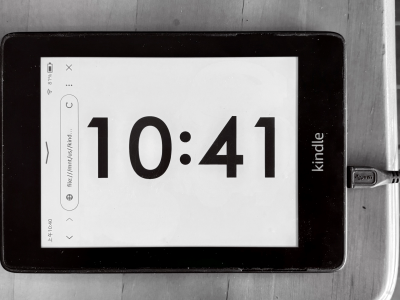
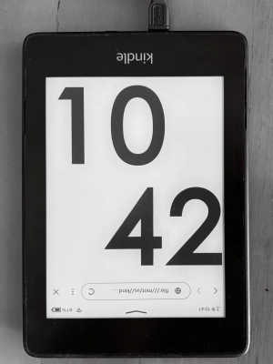

# KindleClock

A minimal wall clock for the Kindle built-in web browser. Shows just `HH:MM` in
Beijing time, rendered edge-to-edge, and updates on the minute boundary.

Plain HTML + CSS + ES5 JavaScript. No build step, no dependencies.

**Live demo:** <https://oldsolo.github.io/KindleClock/>

**中文文档见 [README.zh-CN.md](README.zh-CN.md)**

---

## Why this is unusual

The Kindle browser is a WebKit build from roughly 2009 (Safari 4 era). Most modern web
defaults are wrong on it:

| Feature | Status |
|---|---|
| `<meta name="viewport">` | **ignored** |
| `documentElement.clientWidth` | equals physical pixels; `devicePixelRatio` is always 1 |
| `flexbox`, `grid` | not supported |
| `position: fixed`, `position: sticky` | broken (rendered static) |
| `Promise`, arrow functions, `const`/`let`, `fetch` | not supported |
| `Intl.DateTimeFormat` | not available |
| `mouse*` / `touch*` events | aliases of `click` — bind only `click` |
| `orientationchange` | never fires (`resize` works) |

Verified working on **Kindle 7 (Kindle 499, 600×800)** and **Kindle 10th gen**
(Paperwhite, 1072×1448).

---

## Features

- **Beijing time by default (UTC+8)** — see [Time handling](#time-handling).
- **Tap to rotate** — cycles four orientations, each with its own layout (see below).
- **Fills the screen** in any orientation, on any model.
- **Minute-boundary updates** with no cumulative drift.
- Two-dot separator in landscape; in portrait the two rows touch with no gap.
- Optional dark mode.
- Optional hourly e-ink ghost clearing - see [E-ink ghosting](#e-ink-ghosting).

---

## Screenshots

Real device (Kindle Paperwhite). Tap once to cycle to the next orientation.

| Landscape (default) | Portrait |
|:---:|:---:|
|  |  |

| Angle | Layout |
|---|---|
| `±90°` — landscape | single line `10:41`, rotated; hold the device sideways |
| `0° / 180°` — portrait | `10` top-left, `42` bottom-right, no gap between them |

The Kindle in the landscape shot is lying on its side — that is how it is used; the
page content stays upright for whoever is looking at it.

---

## Running it

Three ways. The page is fully self-contained (relative references to `style.css` /
`app.js`, no network calls, no `localStorage`), so all three behave identically.

### Option A — GitHub Pages (nothing to install)

The page is published at <https://oldsolo.github.io/KindleClock/>. Type that URL
straight into the Kindle browser. It is served from the repository root on the `main`
branch, so every push updates the live site automatically.

Query parameters work here too:

```
https://oldsolo.github.io/KindleClock/?tm=dark
https://oldsolo.github.io/KindleClock/?safe=0.99
```

> **Older devices may not be able to connect.** GitHub requires TLS 1.2, while the
> 2009-era WebKit in a Kindle 7 only negotiates much older TLS versions. If the page
> fails to load there, fall back to Option B. Verified working on the Kindle 10th gen.

### Option B — copy onto the Kindle (most reliable)

1. Connect the Kindle by USB and let the PC mount it.
2. Copy the three files (`index.html`, `style.css`, `app.js`) into a folder on the
   device, e.g. `/mnt/us/kindleclock/`.
3. Eject safely, then open the Kindle browser.
4. Type this into the address bar:

```
file:///mnt/us/kindleclock/index.html
```

The Kindle browser does accept `file://` URLs typed into its address bar, and it renders
`.html` files from `/mnt/us`. Query parameters work here too, e.g.
`file:///mnt/us/kindleclock/index.html?tm=dark`.

This is the most dependable option for a bedside clock — it needs no network at all,
and once the files are on the device the Kindle no longer needs your PC.

### Option C — serve over the LAN

```bash
python -m http.server 8000
```

Then open the Kindle browser and enter `http://<your-pc-ip>:8000/`. Prefer this while
iterating on the files, since editing them on the PC is far easier.

> **Cache tip.** The Kindle browser caches aggressively. After editing files, append a
> cache-buster such as `?v=2` to the URL, otherwise you may keep loading the old version.
> With Option B you can also just delete and re-copy the files.

### Preventing the screensaver

JavaScript cannot keep the screen awake. Disable it at the device level:

- type `~ds` in the search box, or
- create an empty `/mnt/us/TESTD_PREVENT_SCREENSAVER` file and reboot, or
- (jailbroken) `lipc-set-prop -i com.lab126.powerd preventScreenSaver 1`

Without this the browser suspends timers when the screen sleeps, so the clock stops
updating. Note that the Kindle OS draws its own toolbar; a page cannot remove it
without a jailbreak.

---

## Tap to rotate

Each tap steps the rotation by −90°. **Landscape and portrait use different layouts:**

| Taps | Rotation | Layout |
|---|---|---|
| 0 | `90°` | landscape — single line `17 ●● 08` rotated (default) |
| 1 | `0°` | portrait — hours top-left, minutes bottom-right, no gap |
| 2 | `-90°` | landscape again (mirrored order) |
| 3 | `180°` | portrait again (stacked, mirrored) |
| 4 | `90°` | back to landscape |

Both layouts share one set of markup: each digit pair is wrapped in a `.grp` span that is
`display:inline` in landscape (identical rendering to no wrapper at all) and `display:block`
in portrait. Only a `stacked` class on `.clock` switches between them.

In portrait the clock stretches to the full container width so the two alignments differ —
with a shrink-wrapped clock both rows would be the same width and `text-align` would be a
no-op. `#grpH` is left-aligned, `#grpM` right-aligned, and the separator is hidden entirely
(`display: none`, not just its dots — as an `inline-block` it would still reserve
`0.28em` of width and `0.72em` of line height, leaving a gap).

Only `click` is bound. On Kindle, `mouse*` and `touch*` are aliases of `click`, so
binding several of them makes one tap rotate multiple times.

---

## Time handling

**The default is Beijing time (UTC+8), not the device's local time.** This is not a
stylistic choice — it is forced by how the Kindle hides its timezone:

- A Kindle whose system clock reads `13:00` reports `getHours() === 5` — exactly 8 hours off.
- `getTimezoneOffset()` is permanently `0`, and `Intl` does not exist on WebKit 531.
- The device clock being "set to Beijing" never reaches JavaScript. The offset is a
  hidden setting.

So the timezone is **undecidable in JS** and must be stated explicitly. There is no way
to auto-detect it, even when online — an HTTP `Date` header tells you the current
instant, not which timezone the viewer wants. See the research referenced in
[Layout notes](#layout-notes) if you want the long version.

The fixed-zone path is `epoch + tz*3600000` read with `getUTC*`. That pairing matters:

> If you add an offset, read with `getUTC*`. If you don't offset, read with the local
> getter. Mixing them double-counts the shift.

`?tz=local` selects the JS-visible local time, which on a Kindle means UTC.

### Updating on the minute boundary

`setInterval(render, 60000)` looks right but drifts: each tick is scheduled relative to
the previous one, so timer imprecision accumulates. Instead the clock uses a
**recursive `setTimeout`** that re-derives the delay from the current wall clock every
cycle, so lateness in one tick is cancelled out in the next:

```js
function msToNextMinute() {
  var delay = 60000 - ((new Date()).getTime() % 60000);
  if (delay < 150) delay += 60000;   // guard against firing just before the boundary
  return delay;
}
function tick() { render(); setTimeout(tick, msToNextMinute()); }
```

Simulated with a timer that is consistently 350 ms late:

| Approach | Drift after 3 hours |
|---|---|
| `setInterval` | **3000 ms** (linear) |
| recursive `setTimeout` | **350 ms** (bounded) |

The `delay < 150` guard matters more than it looks: firing a few milliseconds early
reads the previous minute and leaves the display a full minute behind.

Note this aligns to the **device** clock, not to a network time source.

---

## E-ink ghosting

E-ink screens keep faint traces of what they showed before. The cause is waveform
selection: a **partial** update drives only the pixels that actually changed, so a
clock that edits 2 of its 4 digits once a minute never pushes the other pixels back
to their resting state. The ghost is not left behind by a sloppy refresh - it is
never refreshed at all.

The only cure is to make **every pixel change at least once**. `?flash=1` does that
once an hour, on the hour:

`14:00  ->  screen goes all black for 800ms  ->  14:00`

It flips the page background to the opposite of the current mode - black in light
mode, white in dark mode. The digits and the separator dots are drawn in exactly the
colour the background is flipping *to*, so they disappear into it on their own, with
no `visibility` trick: every pixel now differs from the frame before, so the
controller has no choice but a full-screen update. After `?flashms` the inline style
is dropped and the background returns to normal. In light mode that needs no restore
step at all - white already is the normal background.

Two caveats worth knowing:

- **It is not the real full flash.** A page reload or a page turn triggers the `GC16`
  waveform, which drives black-white-black and resets every pixel. This is two
  full-area partial updates: it removes most of the ghosting but does not
  mathematically guarantee zero. A reload would be stricter - but it also resets the
  rotation to landscape, because the angle lives in a plain variable with no
  persistence. That trade is deliberate.
- **800ms must exceed one full-screen panel update.** If the ghosting does not
  clear, raise it: `?flashms=1500`.

Off by default; it costs one visible flash per hour.

---

## Query parameters

| Parameter | Default | Effect |
|---|---|---|
| `?tz=<hours>` | `8` | Fixed timezone, e.g. `?tz=9`, `?tz=-5` |
| `?tz=local` | — | JS-visible local time (equals UTC on a Kindle) |
| `?ofs=<ms>` | `0` | Fine offset added to the epoch |
| `?tm=dark` | off | Dark mode |
| `?safe=<0.3..1>` | `0.97` | Fill factor — how much of the screen to use |
| `?debug=1` | off | Measurement readout + calibration graphics |
| `?autochrome=1` | off | Auto-compensate browser chrome (see below) |
| `?ox=<px>` / `?oy=<px>` | `0` | Manual position nudge; overrides `autochrome` |
| `?flash=1` | off | Clear e-ink ghosting once an hour (see below) |
| `?flashms=<ms>` | `800` | How long the hourly clearing flash lasts |

Examples:

```
/                          Beijing time, landscape
/?tz=9                     Tokyo
/?tz=local                 device-visible time
/?tm=dark                  dark mode
/?safe=0.99                fill more of the screen
/?debug=1                  show viewport measurements
/?flash=1                  clear e-ink ghosting every hour
```

### Troubleshooting display issues

**`?debug=1`** prints a corner readout and draws calibration graphics:

- a **red outline** on the container — the layout viewport JS believes in
- a **green crosshair** on the body — the geometric screen centre

```
vp 600x699 scr 600x699 cont 600x699 fs 256px rot 90
```

If the red edge does not meet the physical screen edge, or the crosshair is not at the
red centre, the layout viewport and the visible area disagree. This is the one
discrepancy JS cannot self-detect on a Kindle, because the toolbar is an **overlay**
drawn on top of the page rather than something that squeezes the layout viewport.

`?autochrome=1` derives a correction from the device:

```
oy = (screen.height - clientHeight) / 2
ox = -(screen.width - clientWidth) / 2
```

It is **off by default** because overlay behaviour varies per model — the 10th gen
already renders correctly without it. On a Kindle 7 it yields `oy=50`. `ox` stays `0`
there because the permanent right-hand scrollbar is also an overlay and does not
reduce `clientWidth`; nudge `ox` by hand if the right edge looks emptier than the left.

---

## Layout notes

There are no hardcoded pixel dimensions; every size comes from a runtime measurement.

### The rotation invariant

The container is rotated about its own centre, and its size is chosen per angle so that
**the bounding box after rotation equals the viewport**. A `(w, h)` rect becomes `(h, w)`
under ±90° and is unchanged under 0/180°, therefore:

| Angle | Container size |
|---|---|
| `0°`, `180°` | `vp.w × vp.h` |
| `±90°` | `vp.h × vp.w` |

Getting this backwards still renders upright and correctly centred — it just caps the
clock at ~82% of the screen, so it fails silently.

### Two traps that cost real debugging time

**Centring the swapped container must use `left`/`top`, not `translate`.** With
`transform-origin: 50% 50%`, a `translate(...) rotate(...)` chain displaces the box by
an extra container long/short-side difference (measured 57 px) because the origin sits at
the centre *before* the translate.

**Do not swap axes twice.** The text runs along the container's local x axis, so
`len = container.offsetWidth` and `cross = container.offsetHeight` — with no additional
`upright` conditional. The per-angle container sizing above has already put the long axis
on local-x; swapping again there silently shrinks the font.

### Separator dots

The dots use absolute `em` offsets (`left: 0.07em`, `top: 0.16em / 0.44em`) and `.sep`
has a real `height`. Do **not** use percentage `left` here: old WebKit degrades
`left: 50%` against a zero-height containing block and throws the dots to the far left.
In portrait the whole `.sep` is hidden, so the two rows touch with no gap.

### Font sizing

`fit()` measures, it does not compute. It sets `font-size: 100px`, reads the block's real
`offsetWidth`/`offsetHeight`, then scales to fit the container. This matters because the
the two layouts have completely different bounding boxes — landscape is one line, portrait is
two full-width rows — and hand-written formulas silently get one of them wrong. In portrait
`.clock` is stretched to the full container width, so its `offsetWidth` always equals the
container and carries no information; `fit()` therefore measures one digit pair instead
(summing the two `span` widths inside `#grpH`). The container is sized so that it covers the
viewport exactly after rotation, so "fits in the container" and "fits on screen" are the same
condition.

### Viewport measurement

`measureViewport()` reads `documentElement.clientWidth/clientHeight`. On Kindle these
equal physical pixels and `devicePixelRatio` is always 1, so there is no DPR arithmetic
and no per-model branching.

A fallback table keyed by **exact portrait physical pixels** is consulted only if the live
reading is rejected (≤ 200 px). It uses exact keys rather than `minW`/`minH` thresholds,
because thresholds mis-match the Oasis (1264×1680) onto the Paperwhite 11 entry.

Measured on real hardware:

| Model | Screen | Viewport |
|---|---|---|
| Kindle 499 / Kindle 7 | 600×800 | 600×699 |
| Paperwhite 3/4/5, Scribe | 1072×1448 | 1072×1268 |

---

## Project layout

```
KindleClock/
├── index.html   14 lines   markup + script tag
├── style.css   118 lines   layout, two orientations, separator dots, dark mode
├── app.js      391 lines   viewport, rotation, time, timers
├── img/                    real-device photos of both orientations
├── AGENTS.md               platform constraints and hard-won gotchas
├── README.md               this file
├── README.zh-CN.md        中文文档
└── LICENSE                 MIT

Deployed to GitHub Pages straight from the repository root — there is no build step
and no `gh-pages` branch. GitHub serves the files as-is.
```

---

## References

The Kindle browser behaviour documented above was verified against:

- [Documentation for the Kindle Paperwhite 3 (2015) Web Browser](https://thorgalle.me/notes/documentation-for-the-kindle-browser) — viewport sizes, ES5 feature matrix, event quirks
- [martin-at-ipal/kindle-web-tools](https://github.com/martin-at-ipal/kindle-web-tools) — confirmed *"For JavaScript, the Kindle's timezone is almost always UTC"*

## License

[MIT](LICENSE) © 2026 oldsolo